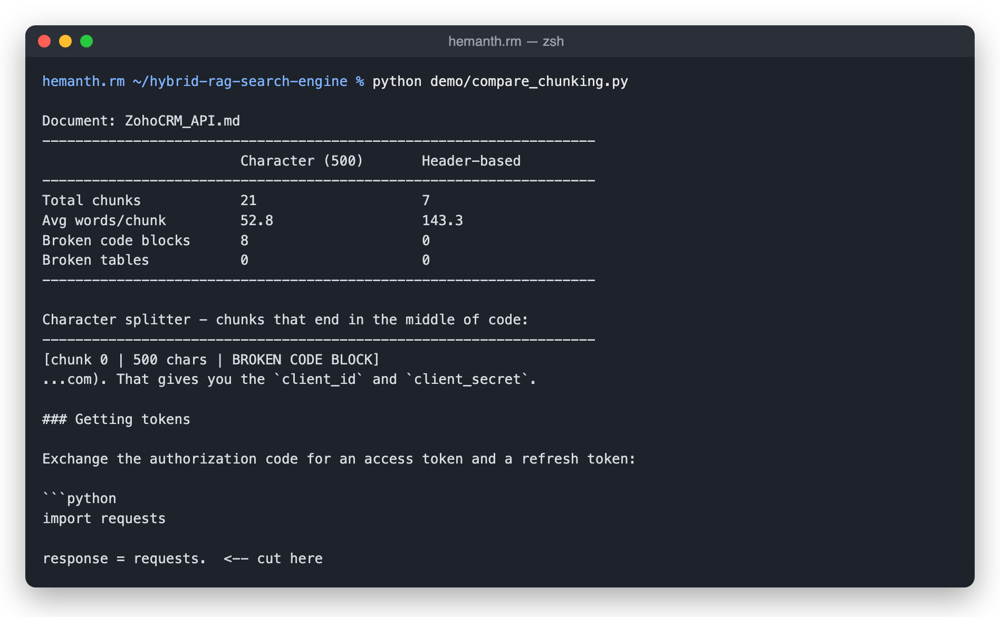
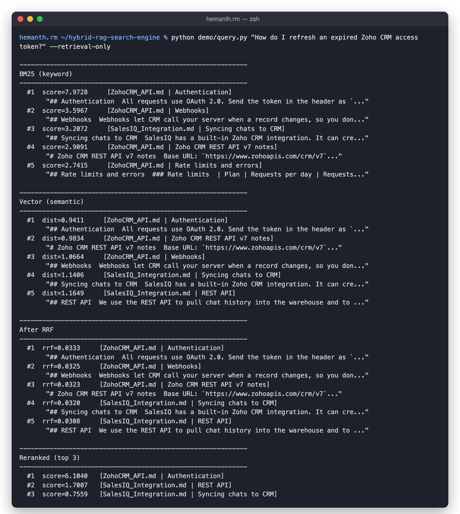

# Hybrid RAG Search Engine

A RAG pipeline over Zoho CRM and SalesIQ developer docs. It combines BM25 keyword search with vector search, reranks the results with a cross-encoder, and has GPT-4o-mini answer with citations.

Built with Python, LangGraph, ChromaDB (Qdrant optional), sentence-transformers, rank-bm25 and RAGAS.

## How it works

```
docs/*.md -> chunk by headers -> embed -> Chroma + BM25 index

query -> retrieve (BM25 + vector, merged with RRF) -> rerank (cross-encoder) -> prompt -> GPT-4o-mini
```

The query side is a LangGraph graph. If any step fails, the graph stops early with the error.

## Things I tried and what I picked

**Chunking.** I started with fixed 500-character chunks, but they kept cutting code samples in half. Splitting at `##` headers (and at `###` when a section is over 400 words) fixed that. On the CRM doc it gives 7 chunks with 0 broken code blocks, compared with 21 chunks and 8 broken ones.



**Hybrid search.** Vector search alone misses exact terms like `refresh_token` or `chat.rated`, and BM25 alone misses paraphrased questions. I run both and merge them with Reciprocal Rank Fusion (`1 / (rank + 60)` summed across both lists), so a chunk that ranks well in both ends up on top.

**Reranking.** The top 5 results go through `ms-marco-MiniLM-L-6-v2`, which scores the question and chunk together, and only the best 3 go to the LLM. In the example below, BM25 and vector search mostly agree on #1. The reranker then separates it clearly from the rest (6.10 vs 1.70).



**Other bits**
- The BM25 index is built once at ingest time and pickled, so a query doesn't pull the whole corpus out of Chroma.
- `vectorstore/qdrant_store.py` has the same functions as the Chroma store, so switching to Qdrant only means changing the import.
- `demo/evaluate.py` runs 6 questions with known answers and scores faithfulness, answer relevancy and context precision with RAGAS. One question has no single-chunk answer, which checks whether the model makes things up.

## Running it

```bash
pip install -r requirements.txt
cp .env.example .env          # add your OPENAI_API_KEY

python demo/compare_chunking.py                  # chunking comparison, no API key needed
python demo/ingest.py                            # build the index
python demo/query.py "How do I refresh an expired Zoho CRM access token?"
python demo/query.py "..." --retrieval-only      # show retrieval only, skip the LLM
python demo/evaluate.py                          # RAGAS scores
```

To use your own documents, put markdown files in `docs/` (or convert a PDF with `python ingestion/pdf_loader.py file.pdf`) and run the ingest step again.

## Layout

```
chunking/      character and header-based splitters
vectorstore/   embeddings, Chroma store, Qdrant store
retrieval/     vector search and hybrid (BM25 + vector + RRF) search
generation/    prompt and OpenAI call
pipeline/      LangGraph nodes and graph
evaluation/    RAGAS scoring
demo/          runnable scripts
docs/          sample Zoho CRM / SalesIQ docs
```
